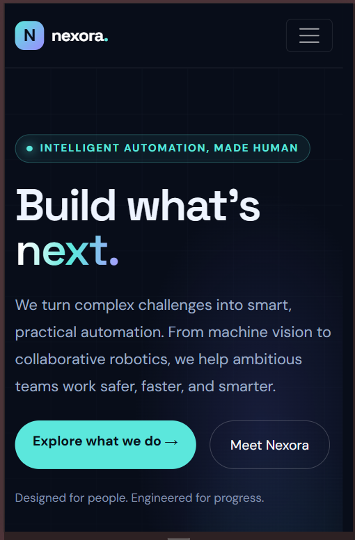

# nexora-robotics-website
HAMK Assignment 13 – Responsive HTML5 company website

# Nexora Robotics — Company Website

## Project Overview

Nexora Robotics is a fictional robotics and AI automation company created as part of **Assignment 13 – Web Page** at HAMK University of Applied Sciences.

The project is a modern, responsive company landing page designed to showcase the company's products, services, mission, and customer experiences. It demonstrates how HTML5, CSS3, JavaScript, and Bootstrap can be used to create an attractive and mobile-friendly website.

**Company slogan:** *Build What's Next.*

## Features

- **Home:** A welcoming hero section with a company slogan and promotional text.
- **About Us:** An introduction to the company's mission and vision.
- **Products:** Examples of robotics, machine vision, and automation solutions.
- **Services:** Information about automation consulting, prototyping, system integration, and technical support.
- **User Stories:** Sample customer testimonials illustrating potential benefits of the company's solutions.
- **Contact Us:** A contact section for visitors interested in the company's services.
- **Responsive Design:** A layout that adapts to desktop, tablet, and mobile screens.
- **CSS Animations:** Smooth transitions, hover effects, gradients, and animated visual elements.
- **JavaScript Interactions:** Interactive page elements and scroll-based animations.
- **Robotics Graphics:** An SVG illustration representing robotics and automation.

## Technologies Used

- **HTML5** — Website structure and content.
- **CSS3** — Styling, responsive layouts, animations, and transitions.
- **JavaScript** — Interactive features and dynamic behaviour.
- **Bootstrap 5** — Responsive grid, layout components, and mobile navigation.
- **Google Fonts** — Typography.
- **SVG** — Scalable robotics illustration.

## Project Structure

```text
nexora-robotics-website/
├── index.html
├── screenshot.png
└── README.md
```

- `index.html` — Main webpage containing the HTML, CSS, and JavaScript.
- `screenshot.png` — Website preview image.
- `README.md` — Project documentation.

## How to Run the Website

1. Clone or download this repository.
2. Open the project folder.
3. Open `index.html` in a web browser such as Google Chrome or Microsoft Edge.

Alternatively, open the folder in Visual Studio Code and use the Live Server extension to run the website locally.

An internet connection is recommended because Bootstrap and Google Fonts are loaded through external CDNs.

## Responsive Design

The website uses Bootstrap's responsive layout system and CSS styling to adapt to different screen sizes. The navigation and content layout are designed to provide a usable experience on desktop computers, tablets, and smartphones.

## AI Assistance

ChatGPT was used to assist with generating website content, structuring the page, suggesting design ideas, and developing HTML, CSS, and JavaScript.

**LLM used:** OpenAI GPT-6 (ChatGPT).

The generated code and website design were prepared for the purposes of this educational assignment.

## Screenshots

Add your actual browser screenshots to this repository and display them here:

### Desktop View


### Mobile View



*Replace these image references with the actual screenshot filenames you upload to GitHub.*

## Project Purpose

The purpose of this project is to demonstrate the creation of a modern HTML5 company landing page with responsive design, engaging graphics, animations, and essential company information.

## Disclaimer

Nexora Robotics is a fictional company created for educational purposes. Customer stories and company information are illustrative examples, not claims about a real business.
